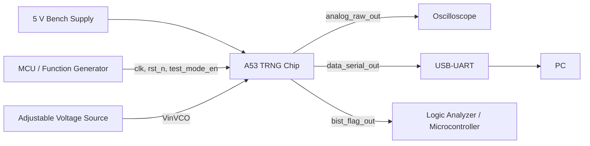

# Chip Test Plan – Team A53 TRNG

The chip is a True Random Number Generator (TRNG) with an analog part and a digital part.

The analog part consists of four current-starved ring oscillators whose outputs are XORed together. Their speed is controlled by a control voltage on `VinVCO`.

The digital part samples this signal using the system clock, performs health tests (Repetition Count Test and Adaptive Proportion Test), and sends the generated data through a serial output pin.

After fabrication, we want to verify that both parts work correctly and compare the measured oscillator behaviour with the post-layout NGSpice simulations performed earlier.

_Note: This document will be updated as the test setup develops._

## Block Diagram

_The final equipment configuration and measurement connections will be updated as the test setup is finalized._

## Main Features to Test

1. Power consumption
2. Reset and enable behaviour
3. Ring oscillator output versus `VinVCO`
4. Serial output
5. Health-test flag
6. Statistical Randomness of the output data
7. Supply voltage and clock frequency
8. Default pin states

## Test Descriptions

### 1. Power Consumption

We measure the supply current under different operating conditions.
These measurements are repeated at different `VinVCO` values since the oscillator bias current depends on it.

### 2. Reset and Test Enable Behaviour

We apply reset and then enable test mode of the chip through `test_mode_en`.

To verify:

- The outputs come out of reset in the expected state.
- The TRNG works normally when `test_mode_en` is low.
- It moves to test mode when `test_mode_en` is asserted.

### 3. Ring Oscillator Output Versus VinVCO

 `VinVCO` is swept across the intended operating range and parameters such as frequency, amplitude and duty cycle are measured on `analog_raw_out`.

### 4. Serial Output

The `data_serial_out` is captured using a USB-UART adapter.
A logic analyzer can be used to inspect the timing if the USB-UART adapter reports errors. The bytes are captured and the serial framing is verified to be correct. It is also checked to see whether there are any communication errors.

### 5. Health-Test Flag

The `bist_flag_out` signal is monitored during normal operation and a fault condition is then introduced. For example, we lower `VinVCO` until the oscillators stop. We expect the flag to drop when the output stops changing. We would also try to log how long the flag stays high during an extended normal operating period.

### 6. Statistical Randomness of Output Data

A sufficient number of bits are collected through the serial output at several `VinVCO` values.
The collected data is analyzed using different standard tests such as NIST SP 800-22 statistical tests and NIST SP 800-90B entropy estimation. 
To examine the raw source separately from the on-chip sampling, we can also record `analog_raw_out` using a fast logic analyzer at a known sampling rate and analyze the captured data.

